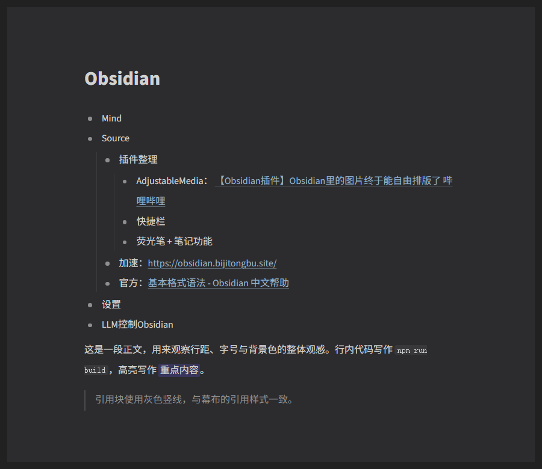

# MubuStyle

把 Obsidian 的笔记外观换成**幕布（Mubu）风格**：字形与字号、行距、纸张式背景、实心小圆点与缩进参考线。



## 特性

- **字形**：直接用幕布客户端的字体栈 —— 拉丁字母与数字用 **Source Sans Pro**（插件内置，取自
  幕布客户端 `app.css` 的 `SourceSansPro`），中文回落 PingFang SC / 微软雅黑；
  并复刻幕布的 `-webkit-font-smoothing: antialiased`，笔画粗细与幕布一致
- **字号 / 字间距 / 行距**：正文 16px、字间距可调、行距 **2.1** 倍（按截图实测：幕布行距 39.5px / 本插件 35.5px 后修正）
- **主题强调色**：按钮、开关、选区、复选框用幕布紫 `#5854d4`（取自幕布侧栏按钮）；正文链接仍是灰色下划线
- **纸张式背景**：外壳 `#121212` → 桌面 `#212121` → 纸张 `#2c2c2f` 三层，纸张四周留白 12px、圆角 4px
- **深色外壳**：顶栏、标签栏、状态栏、左右侧栏一起压深，不再是 Obsidian 原生的浅灰
- **实心圆点 + 圆点折叠**：灰色实心小圆点，圆点与文字之间留出 1.2em 的空隙；
  鼠标移上去圆点外浮出 **18px 半透明圆盘**（`box-shadow` 6px spread，200ms 过渡），
  **点击圆点即可折叠/展开子项**（实时预览与阅读视图都支持），折叠后圆盘保持浅灰、圆点不变紫
- **缩进参考线**：父级下方拉出连接子项的细线，和幕布一样淡淡的一条
- **配置文件**：一键把当前设置存到插件目录，换电脑或重装后直接读回
- **动态悬浮工具栏（按幕布 6.1.0 实测）**：选中**单行里的文字**时浮出**单行**图标横栏，
  顺序与幕布一致：`B I U S | 荧光笔 字体颜色 H1 | 待办 表情 列表 图片 表格 | 链接 建立关联 代码 ···`。
  浮层按**鼠标更靠近选区的上半还是下半**自动放到选区上方或下方（越界自动翻转）；
  入场是 60ms 的 `opacity + scale(0.95→1)`，键盘 Shift+方向键改选区时用 200ms 滑动到新位置，
  鼠标拖选则瞬间跟随；选区已经加粗/斜体/下划线/删除线/行内代码/高亮/字体颜色时，
  对应按钮加 `.is-active`，标题按钮直接显示当前级别
- **悬浮子菜单**：荧光笔 / 字体颜色 / 标题 / 表情 / 更多只要鼠标停一下就**贴着按钮展开**
  （100ms 位移+淡入，移开 180ms 收起），色块 hover 放大到 1.2 倍（200ms）
- **表情选择器**：「表情」和行首菜单的「添加图标」共用同一个面板：顶部搜索 + 随机，下面按
  **最近使用 / 常用 / 表情 & 人物 / 手势 / 符号 / 物品 / 自然 / 数字**分组，收录 150+ 个表情；
  点选后直接插入光标处，最近使用的会记住（localStorage）
- **「⋯」更多菜单**：**复制** / **清除格式** / **删除**（红色危险项），中间带分隔线，
  入场 160ms 缩放+淡入
- **建立关联**：工具栏「链接」右边单独一个按钮（插入 `[[]]`，有选中文字时包成 `[[文字]]`），
  不再放在「⋯」菜单里
- **多选竖排菜单**：选中**跨行/多个主题**时，改为幕布那种贴在选区右侧的竖排菜单：
  `H1 H2 H3 T`（当前级别高亮成紫色）/ `B I U S` / 字体颜色 › / 荧光笔 › / 添加待办 /
  添加编号 / 复制 / 删除，底部显示「选中 N 行 · N 字」，子菜单从行右侧弹出
- **行首块菜单**：鼠标移到某行左侧出现「⋯」（hover 圆形背景 200ms），点开自动选中整行文字，
  可改标题、加粗、打荧光、**添加图标**（hover 从右侧弹出 emoji，120ms 位移+淡入）、
  **折叠/展开子主题**（和点圆点共用同一个折叠函数）、转待办、插入表格、复制或删除（红色危险项），
  菜单 160ms 缩放+淡入，底部显示选中字数
- **荧光笔**：不用幕布那种实色底（会压住文字），改成 26% 透明度的低饱和底 + 保留原文字颜色。
  标准高亮写 `==文字==`；7 种彩色高亮写成 `<mark class="mubu-hl mubu-hl-amber">文字</mark>`，
  实时预览与阅读视图都能正常上色（光标停在那一行时 Obsidian 会把标签原文显示出来，属正常现象）
- **字体颜色**：6 色，写成 `<span class="mubu-fg-green">文字</span>`；跨行选中时按段分别包一层，
  避免一个标签跨过空行把几段合并成一段
- **细节**：链接下划线、无边框表格、细窄滚动条、灰色引用条

## 安装

1. 把 `main.js`、`manifest.json`、`styles.css` 复制到
   `<你的仓库>/.obsidian/plugins/mubu-style/`
2. 重启 Obsidian（或 Ctrl+R 重载）
3. 在「设置 → 第三方插件」中启用 **MubuStyle**
4. 打开「设置 → MubuStyle」按喜好微调

## 设置项

| 分组 | 项目 | 默认 | 说明 |
| --- | --- | --- | --- |
| 基础 | 启用幕布样式 | 开 | 关闭即完全还原主题外观 |
| 基础 | 配色预设 | 幕布暗色 | 切换后仍可单独改色 |
| 排版 | 字体方案 | **幕布（Source Sans Pro + 系统中文字体）** | 四选一：幕布 / 系统 / 跟随 Obsidian / 自定义 |
| 排版 | 内置字体状态 | — | 显示内置字体是否加载成功，可手动「重新加载」 |
| 排版 | 字号 / 字间距 / 行距 | 16px / 0em / 2.1 | 「跟随 Obsidian」时字号以 Obsidian 为准 |
| 排版 | 正文宽度 | 0 | 0 = 跟随主题 |
| 颜色 | 顶栏、窗口、纸张、侧栏、正文、次要文字、强调色 | — | 颜色选择器 |
| 细节 | 幕布圆点 | 开 | 实心灰色小圆点 |
| 细节 | 缩进参考线 | 开 | 父级下方的连接细线 |
| 细节 | 纸张式背景 | 开 | 桌面 + 留白圆角纸张 |
| 细节 | 纸张留白 | 12px | 0 表示铺满 |
| 细节 | 美化滚动条 / 侧栏配色 | 开 / 开 | — |
| 编辑辅助 | 选中浮动工具栏 | 开 | 选中文字后浮出格式栏 |
| 编辑辅助 | 行首块菜单 | 开 | 行首「⋯」整行操作 |
| 编辑辅助 | 圆点折叠 | 开 | 点击列表圆点折叠/展开，悬停显示幕布式圆盘 |
| 配置文件 | 保存 / 读取配置 | — | 写入插件目录下的 `mubu-style.config.json` |

命令面板：

- `MubuStyle: 切换幕布样式（开/关）`
- `MubuStyle: 使用幕布暗色配色` / `使用幕布亮色配色`
- `MubuStyle: 保存配置到插件目录` / `从插件目录读取配置`

配置文件位置：`<vault>/.obsidian/plugins/mubu-style/mubu-style.config.json`，
内容形如：

```json
{
	"plugin": "mubu-style",
	"version": "1.2.0",
	"savedAt": "2026-10-30T11:58:00.000Z",
	"settings": { "fontSize": 16, "lineHeight": 1.9, "...": "..." }
}
```

## 开发

```bash
npm install
npm run dev     # 监听 main.ts，输出 main.js
npm run build   # 类型检查 + 压缩构建
```

`preview/mubu-preview.html` 是脱离 Obsidian 的静态预览页（含纸张外框、圆点、参考线），
调色调间距时直接浏览器打开即可；`preview/check.html` 输出关键计算样式，`preview/sample*.html`
用来从截图里取色。

## 说明

- 插件只往 `body` 上挂 `mubu-style` / `mubu-dots` / `mubu-guides` / `mubu-paper` /
  `mubu-bullet-fold` 等类名和 `--mubu-*` 变量，所有样式都限定在 `body.mubu-style` 下，
  关闭或卸载后不留痕迹。
- 悬浮栏与菜单的动效数值（60ms 入场、200ms 跟随、100ms 子菜单、200ms 色块、
  160ms 块菜单、120ms emoji 二级菜单、18px 圆盘）来自幕布桌面端 **6.1.0** 的实测。
- 与主题（如 Minimal）共存：通过 `!important` 覆盖主题的字体、行距、标题与列表变量。
- **和 Annotation Marker 共存**：悬浮栏不再只依赖 mouseup 那一瞬间的 DOM 选区
  （CodeMirror 有时要晚一帧才把选区落到文档上，第三方插件在 mouseup 里抢焦点时更明显），
  会回退到编辑器自身的选区并用 `coordsAtPos` 定位，松手后再补跑几帧；
  行首「⋯」也会在松手时按指针所在行重新贴出来。选中文字后浮层和「⋯」不会再时有时无。
- **Annotation Marker 打过的补丁**（3.0.18，`main.js` + `styles.css`，共 32 项改动）：
  - **「标注模式」入口从左侧功能区挪到笔记右上角操作区**（和「编辑 / 更多」并排），
    批注视图自己的标签里也挂这个图标（作用变成关闭，图标高亮成紫色），
    所以启动和关闭都能在同一个位置点到；命令 `启动/关闭标注模式` 常驻
    「设置 → 快捷键」列表，可以自己绑键（本仓库默认是 `F3`）；
  - 标注菜单、点击已有标注、快捷颜色命令、移动端选区菜单只在**阅读模式**生效，编辑模式交给编辑器；
  - 标签页标题去掉「【标注视图】」前缀；从阅读/编辑界面进入批注视图统一进**阅读+标注**，
    关闭后恢复进入前的阅读/编辑模式；
  - 批注视图里 `./`、`../` 相对路径图片按原笔记目录解析：既修正内嵌图与 HTML ``，
    也把 `metadataCache.getFirstLinkpathDest` 的 `sourcePath` 重定向回原笔记，
    **Adjustable Media 的多图布局块**因此也能正常出图；
  - 右下角入口换成 Obsidian 风 Lucide 图标；「添加标注」悬浮窗与「批注列表」整体收紧，
    去掉「选择颜色立即标注」文字，**点空白处即可关闭悬浮窗**；
  - 颜色选项从圆形改成 **20px 圆角方形**（和幕布色板一致）；批注列表**贴住入口图标**，
    拖动图标时一起移动；「跨段」徽标内联到正文前、批注换行到正文下面，不再挤成多列；
  - 打开批注视图时会先把原笔记的外部改动合并进标注文件，补丁保护每条标注的批注内容，
    不会被正文覆盖（原插件在两边不同步时可能把正文写进批注字段）；
  - 标注菜单、批注列表、右键菜单、悬浮提示、批注侧栏、导入导出框统一改用幕布字体
    （这些浮层原本走 `--font-interface` 系统界面字体），与正文同一套字形和抗锯齿；
  - 批注列表标题栏压到 28px；条目上下两段——上边「跨段」+ 原文（暗色），下边批注
    （亮白 12.5px，前面是和外层入口同一个 Lucide 图标）；入口图标拖到哪儿会记住，
    重启 Obsidian 也回到原位；
  - 「添加标注」窗口右下角可拖大拖小，**批注输入框自己的右下角可拖高度**，两者尺寸都会
    记住；「批注内容」与字数同一水平线，输入框紫色描边常驻；注音默认收成
    一条「上方一条分隔线」的行（无底色、26px、上下对称，圆圈与文字对齐），点一下才展开；
    悬浮窗和批注列表的**标题栏同尺寸**（28px、12px 字、18×18 关闭按钮，标题与 × 同中线），
    批注列表**条目之间加细分隔线**；**点击已有批注也开这个窗口**
    （标题变「批注」、预填批注 / 颜色 / 注音，「保存」改为更新原标注），不再弹「标注详情」页；
  - Adjustable Media 的图片在布局尺寸就位前先不显示，开 / 关批注视图时不会再「先变大再回落」
    （换文件那一帧由 `prepareVmlBoot()` 盯住，之后由 `gateVmlBoot()` 精确给图片打标）；
  - 批注视图顶部不会再冒出「文件夹名&.笔记名」这种标题：假文件的 `basename` 被换回原笔记名，
    Obsidian 每次重渲染都拿到正确标题；
  - 滚到页面中间再开 / 关批注视图不会「跳回顶部」：滚动位置从可见容器读，
    过渡期间以「视口上方最近的标题」为锚点按帧校正。
  原文件备份在同一目录的 `main.backup-20261101.js`，改动清单见 `MUBUSTYLE-PATCH.md`；
  升级该插件会覆盖补丁，按同样的锚点重打即可。
- 配置带 `settingsVersion`：从 1.1 升级到 1.2 时，字号/行距/字间距/字体开关会迁移到新默认值，
  自己调过的颜色、纸张留白等保持不变。
- 字体：`fonts/` 里是幕布客户端自带的 Source Sans Pro（OFL 1.1，见 `fonts/NOTICE.md`）。
  字体以 **base64 内嵌的 woff2**（子集化后共约 70KB）注册为 `"Mubu Sans"` ——
  Obsidian 用 `app://` 加载字体属于跨源，会被 Chromium 的字体 CORS 拦掉，所以不能走文件路径。
  删掉 `fonts/` 插件也能用，只是拉丁字母回落到系统字体。
- 字体需要重新生成时：`python scripts/build-fonts.py`（源 TTF 在 `fonts/`，产物在 `fonts/build/`）。
- 无网络请求，不读写笔记内容。
